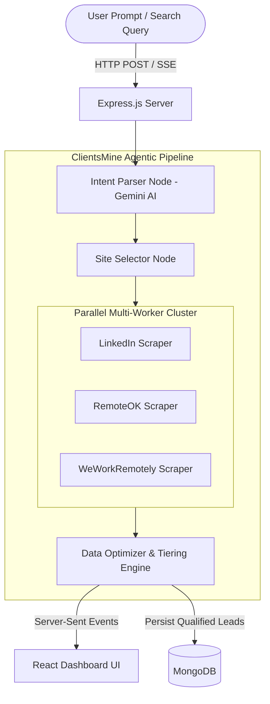

# ClientsMine ⚡

> **ClientsMine** is an agentic-first client acquisition and job intelligence platform engineered to help businesses, agencies, and freelancers discover high-intent clients and relevant opportunities directly from natural-language queries.

[](https://nodejs.org/)
[](https://react.dev/)
[](https://vitejs.dev/)
[](https://tailwindcss.com/)
[](https://ai.google.dev/)
[](LICENSE)

---

## 📖 Overview

Finding qualified leads and relevant job opportunities traditionally requires hours of manual searching across fragmented boards, parsing outdated posts, and digging for contact information. 

**ClientsMine** automates the entire discovery and qualification pipeline through an autonomous multi-agent architecture. You simply enter a natural-language search query (e.g., *"Find clients who posted looking for a freelance React & Node.js developer in the last 24 hours"*), and ClientsMine's agent pipeline analyzes your intent, selects target channels, crawls the web in parallel, cleans and deduplicates listings, filters stale data, ranks leads by contactability, and streams qualified opportunities to your dashboard in real time.

---

## ✨ Key Features

- 🧠 **Agentic Intent Routing & Parsing**  
  Uses Google Gemini models to deconstruct raw user queries into structured parameters: targeted roles, technology stacks, time constraints, seniority, and geographic filters.

- ⚡ **Concurrent Multi-Source Scraping**  
  Orchestrates parallel scrapers across premier tech job boards and professional networks (LinkedIn Guest API, RemoteOK, WeWorkRemotely, and more) using `Promise.allSettled`.

- 📡 **Real-Time SSE Streaming & Live Status Updates**  
  Delivers results and second-by-second agent status pills to the user interface using Server-Sent Events (SSE). No long spinner screens—leads appear dynamically the millisecond each scraper settles.

- 🎯 **Intelligent Lead Tiering (Email-First)**  
  Automatically scores and prioritizes incoming leads into actionable tiers:
  - **Tier 1 (Highest Priority)**: Leads with direct contact emails.
  - **Tier 2 (Medium Priority)**: Leads with phone numbers, hiring manager profiles, or direct company websites.
  - **Tier 3 (Standard)**: Direct job listing URLs and applications.

- ⏳ **Strict Freshness Engine**  
  Enforces an automated temporal filter discarding stale postings (>60 days), prioritizing recent high-response opportunities (within 24 hours to 30 days).

- 🛡️ **Anti-Bot & Stealth Crawling**  
  Equipped with dynamic user-agent rotation, stealth Puppeteer configurations, and Cheerio-first fast parsers to ensure reliable, respectful data extraction without IP throttling.

- 💾 **Persistent Search History & Lead Management**  
  Maintains user search histories, lead saves, and personalized search preferences backed by MongoDB.

- 🎨 **Modern Glassmorphic UI**  
  Built with React 19, Tailwind CSS v4, and Motion animations for fluid transitions, searchable lead tables, status dashboards, and responsive controls.

---

## 🏗️ System Architecture



---

## 📁 Repository Structure

```plaintext
clientsmine/
├── .agents/                        # Agent workflows and scraper skill definitions
│   └── skills/clientsmine_scraper/ # Scraper architecture & maintenance guidelines
├── backend/                        # Express.js & Agentic AI Backend
│   ├── configs/                    # Database (Mongoose) configuration
│   ├── controllers/                # Route controllers (Auth, AI Analyzer, Leads)
│   ├── Implementations/            # LangGraph / AI orchestration nodes & state
│   │   ├── nodes/                  # Intent parser, scraper agent, data collector
│   │   └── streamingOrchestrator.js# Parallel SSE streaming engine
│   ├── middlewares/                # JWT authentication & request validation
│   ├── models/                     # Mongoose models (User, ScrapedLead, History)
│   ├── Optimization/               # Date filtering, email extraction, lead tiering
│   ├── routers/                    # Express route declarations (/api/auth, /api/ai, etc.)
│   ├── utils/                      # Anti-bot scraping utils, token generators
│   ├── .env.example                # Backend environment configuration template
│   └── server.js                   # Application entry point
├── frontend/                       # React 19 + Vite Frontend
│   ├── public/                     # Static assets and icons
│   ├── src/
│   │   ├── components/             # Reusable UI components & Leads table
│   │   ├── context/                # AuthContext & ToastContext
│   │   ├── pages/                  # Views (Dashboard, History, Login, Signup, Pricing)
│   │   ├── sections/               # Landing page modules
│   │   ├── App.jsx                 # Route management
│   │   └── main.jsx                # React root mount & Axios setup
│   ├── package.json
│   └── vite.config.js
├── .gitignore                      # Secure git exclusions (credentials, node_modules)
└── README.md                       # Project documentation
```

---

## 🚀 Getting Started

### Prerequisites

Ensure you have the following installed on your machine:
- [Node.js](https://nodejs.org/) (v18.0.0 or higher recommended)
- [MongoDB](https://www.mongodb.com/) (Local instance or MongoDB Atlas cluster)
- [Google AI Studio Gemini API Key](https://aistudio.google.com/)

---

### Installation & Setup

#### 1. Clone the Repository
```bash
git clone https://github.com/PratapShaurya90/clientsmine.git
cd clientsmine
```

#### 2. Configure the Backend

Navigate to the `backend` folder and install dependencies:
```bash
cd backend
npm install
```

Create your `.env` configuration file from the template:
```bash
cp .env.example .env
```

Open `.env` and fill in your environment variables:
```env
PORT=5001
NODE_ENV=development
MONGO_URI=mongodb://localhost:27017/clientsmine
JWT_SECRET=your_jwt_secret_key_here
GEMINI_API_KEY=your_gemini_api_key_here
```

Start the backend server:
```bash
npm start
# or with nodemon if installed:
# npx nodemon server.js
```
The backend will launch on `http://localhost:5001`.

---

#### 3. Configure the Frontend

Open a new terminal tab, navigate to `frontend`, and install dependencies:
```bash
cd frontend
npm install
```

Launch the Vite development server:
```bash
npm run dev
```
The frontend application will be accessible at `http://localhost:5173`.

---

## 🔌 API Overview

| Method | Endpoint | Description | Protected |
| :--- | :--- | :--- | :---: |
| `POST` | `/api/auth/signup` | Register a new user account | No |
| `POST` | `/api/auth/login` | Authenticate user and issue JWT tokens | No |
| `POST` | `/api/auth/refresh-token` | Renew expired session tokens | No |
| `GET` | `/api/auth/me` | Retrieve profile of authenticated user | Yes |
| `POST` | `/api/ai/client` | Trigger agentic search & stream leads via SSE | Yes |
| `GET` | `/api/leads/history` | Retrieve past scraped search queries & leads | Yes |
| `DELETE`| `/api/leads/history/:id` | Remove a search record from user history | Yes |

---

## 🔒 Security & Data Hygiene

- **Zero Secret Leakage**: All keys, environment configurations, logs, and `node_modules` are strictly excluded from version control via `.gitignore`.
- **Anti-Scraping Protection**: Requests use randomized browser profiles and rate limiting to adhere to platform policies.
- **Password Hashing**: User credentials are encrypted with `bcrypt` before database persistence.
- **Secure Token Storage**: Authentication tokens utilize HTTP-only cookies and Bearer headers with short expiry lifecycles.

---

## 🤝 Contributing

Contributions, issues, and feature requests are welcome!

1. Fork the Project
2. Create your Feature Branch (`git checkout -b feature/AmazingFeature`)
3. Commit your Changes (`git commit -m 'Add some AmazingFeature'`)
4. Push to the Branch (`git push -u origin feature/AmazingFeature`)
5. Open a Pull Request

---

## 📄 License

This project is licensed under the ISC License.
